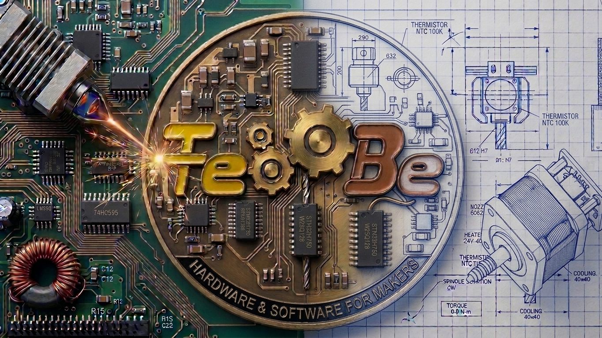

  

<h1 align="center">FeBe - logiciels libres pour makers</h1>

  <b>CNC, laser, impression 3D, électronique : des outils libres et gratuits, pensés pour l'atelier.</b> 
  <i>CNC, laser, 3D printing, electronics: free and open-source tools, built for the workshop.</i>

  
  
  

## Projets / Projects

| | Projet | Description | Statut |
|:---:|---|---|---|
|  | **[c2d_to_nc](https://github.com/FeBeSoft/c2d_to_nc)** | Projet Carbide Create (.c2d) vers G-code Grbl : glisser, vérifier, exporter. <i>.c2d to Grbl G-code: drag, check, export.</i> | ✅ Disponible |
|  | **[MakerCraft](https://github.com/FeBeSoft/makercraft)** | Atelier 2D/3D : CNC, laser, PCB et pilotage de machines. <i>2D/3D workbench: CNC, laser, PCB, machine control.</i> | 🛠️ En développement |
|  | **[GravéoCraft](https://github.com/FeBeSoft/graveocraft)** | Logiciel pour programmateurs universels (TOP853, T48...). <i>Software for universal device programmers.</i> | 🛠️ En développement |
|  | **[Isel Jog](https://github.com/FeBeSoft/iseljog)** | Déplacement manuel et capture série pour fraiseuse Isel CPM 2018. <i>Jog and serial capture for the Isel CPM 2018.</i> | 🛠️ En développement |
|  | **[UIdeCraft](https://github.com/FeBeSoft/uidecraft)** | Concepteur d'interfaces egui façon Delphi. <i>Delphi-style form designer for egui.</i> | 🛠️ En développement |

## Technologies

  
  
  
  
  
  

## Philosophie / Philosophy

Tous les logiciels FeBe sont **libres (GPL-3.0) et gratuits**, et le resteront. Le soutien sur Patreon sert uniquement à aider le développement.

*All FeBe software is free and open source (GPL-3.0), and will stay that way. Patreon support only helps development.*

## Contact

- Général : contact@fe-be.fr
- Site : [fe-be.fr](https://fe-be.fr)
